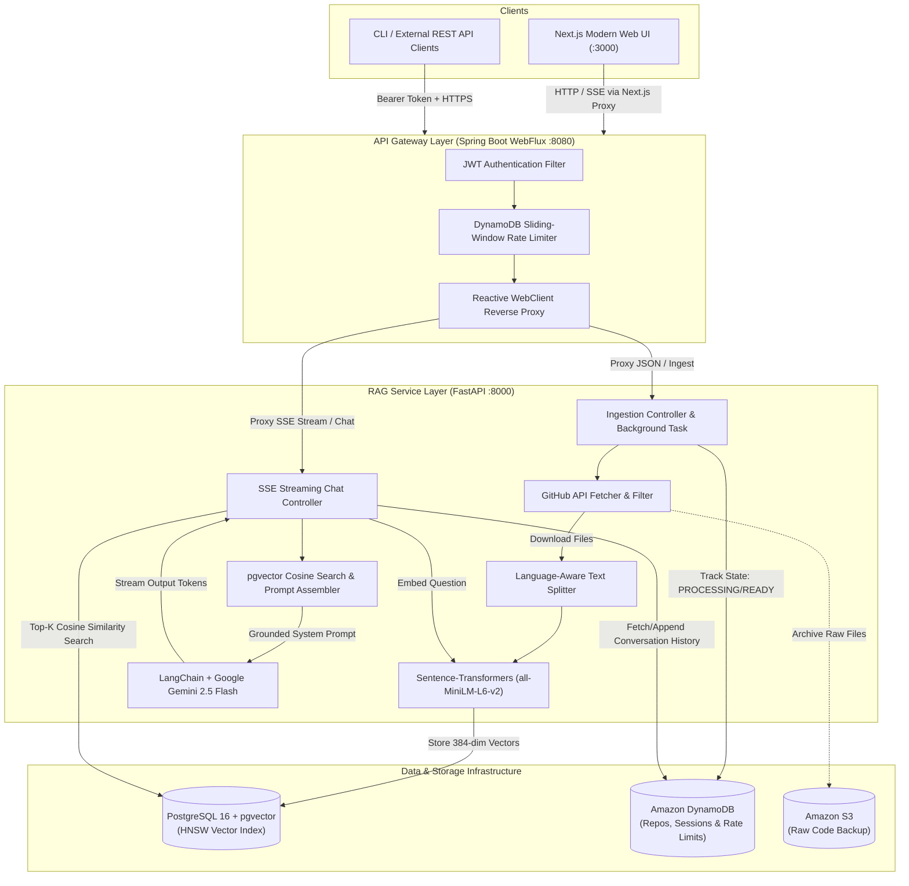
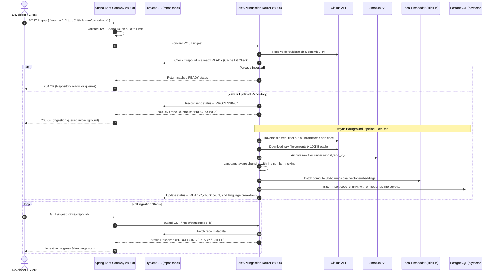
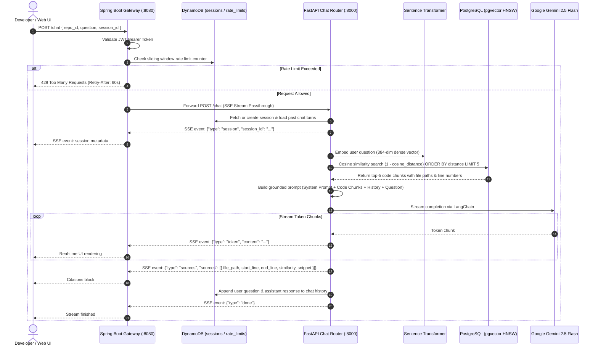

# Code RAG — AI-Powered Codebase Intelligence

>  **Live Application:** [https://codrag-xi.vercel.app/](https://codrag-xi.vercel.app/)


**Code RAG** is an end-to-end Retrieval-Augmented Generation (RAG) platform designed specifically for software engineering codebases. Point it to any GitHub repository, and it indexes, parses, and embeds the code into a vector database, enabling conversational semantic queries grounded in actual source files with precise, line-level citations.

---

## How It Can Help

Navigating, auditing, and ramping up on large, unfamiliar software repositories is time-consuming and error-prone. Code RAG accelerates developer productivity and repository comprehension in several key ways:

- **Instant Codebase Onboarding**: New developers can ask high-level architectural questions (*"How does authentication and session middleware work in this project?"* or *"Where is the database connection pool initialized?"*) and receive immediate explanations referencing exact source files.
- **Hallucination-Free Code Explanations**: Generic LLMs often fabricate API signatures, invent non-existent methods, or reference deprecated libraries. Code RAG enforces strict grounding: answers are generated **only** from retrieved, actual source code snippets. If information does not exist in the codebase, the system explicitly informs you.
- **Precise Source Citations & Line Numbers**: Every response is attributed to its origin with exact file paths and line ranges (e.g., `src/middleware/auth.ts:42-88`) along with semantic similarity scores, enabling instant verification.
- **Language-Aware Chunking**: Rather than treating code as raw text, the system uses AST- and syntax-aware splitting across 20+ programming languages (Python, TypeScript, Go, Java, Rust, C/C++, etc.), keeping function definitions, class declarations, and logic blocks intact.
- **Cost-Effective Semantic Search**: Dense vector embeddings are generated locally using `all-MiniLM-L6-v2` (384-dimensional vectors) at zero API cost, combined with PostgreSQL `pgvector` HNSW indexing for sub-50ms vector similarity searches.
- **Production-Grade Enterprise Architecture**: Features a reactive non-blocking Spring Boot API gateway, JWT-based client authentication, sliding-window rate limiting backed by DynamoDB, and Server-Sent Events (SSE) for low-latency streaming responses.

---

## Architecture & Request Flow Diagrams

### High-Level System Architecture



---

### Request Flow: Repository Ingestion

This workflow shows what happens when a repository is submitted for indexing:



---

### Request Flow: Streaming Chat & Query with Citations

This workflow shows the end-to-end journey of a question answered via Server-Sent Events (SSE):



---

## How to Use This Project

Once the application is running, Code RAG can be used through three different interfaces: the **Interactive Web UI**, the **REST API Gateway**, or the direct **CLI Interface**.

### 1. Using the Interactive Web UI

The Web UI provides a browser-based developer workspace for indexing codebases and conducting real-time Q&A.

1. **Access the Web Dashboard**: Open your browser and navigate to the live deployment at [https://codrag-xi.vercel.app/](https://codrag-xi.vercel.app/) (or `http://localhost:3000` when running locally).
2. **Ingest a Repository**:
   - Paste any valid public GitHub URL into the repository input bar (e.g., `https://github.com/expressjs/express` or `https://github.com/pallets/flask`).
   - Alternatively, click any of the pre-configured sample repository badges.
   - Click **Index Repository**.
3. **Monitor Ingestion Progress**:
   - The UI automatically polls the status endpoint.
   - You will see live statistics including the generated `repo_id`, target commit SHA, total chunks created, and language breakdown (e.g., JavaScript: 85%, TypeScript: 15%).
4. **Interactive Grounded Chat**:
   - Enter your question in the message bar (or click one of the suggested query chips).
   - Watch the response stream in real-time token-by-token.
   - View formatted Markdown, headers, lists, and syntax-highlighted code blocks.
5. **Inspect Citations**:
   - Below the assistant's answer, expand the **Sources** drawer to inspect each cited code chunk.
   - Each source reveals the exact relative file path, line numbers (e.g., `lib/router/index.js:45-98`), similarity confidence score, and the raw context snippet passed to the model.
6. **Multi-Turn Context**:
   - Ask follow-up questions (e.g., *"Can you show an example of how that middleware is registered in an app?"*). The session preserves conversation history for cohesive multi-turn dialogues.

---

### 2. Using the REST API & Gateway

All API calls can be routed through the Spring Boot API Gateway (default port `:8080`), which secures endpoints with JWT authentication and applies rate limiting.

#### Step A: Generate an Authentication Token

The gateway exposes an authentication endpoint that generates signed JWTs:

```bash
curl -X POST http://localhost:8080/auth/token \
  -H "Content-Type: application/json" \
  -d '{"user_id": "developer_alice"}'
```

**Response:**
```json
{
  "token": "eyJhbGciOiJIUzI1NiIsIn...",
  "user_id": "developer_alice",
  "expires_in": "86400"
}
```

Save the returned token:
```bash
export TOKEN="eyJhbGciOiJIUzI1NiIsIn..."
```

---

#### Step B: Ingest a GitHub Repository

Submit a GitHub repository URL for asynchronous ingestion:

```bash
curl -X POST http://localhost:8080/ingest \
  -H "Authorization: Bearer $TOKEN" \
  -H "Content-Type: application/json" \
  -d '{"repo_url": "https://github.com/expressjs/express"}'
```

**Response:**
```json
{
  "repo_id": "github_expressjs_express_a20b406560b3",
  "status": "PROCESSING",
  "message": "Ingestion started. Poll /ingest/status for updates."
}
```

*(If the exact commit was already indexed, it returns `status: "READY"` immediately).*

---

#### Step C: Poll Ingestion Status

Check if the repository has finished chunking and embedding:

```bash
curl -X GET http://localhost:8080/ingest/status/github_expressjs_express_a20b406560b3 \
  -H "Authorization: Bearer $TOKEN"
```

**Response (when complete):**
```json
{
  "repo_id": "github_expressjs_express_a20b406560b3",
  "status": "READY",
  "repo_url": "https://github.com/expressjs/express",
  "commit_hash": "a20b406560b3d68ef...",
  "chunk_count": 348,
  "language_breakdown": {
    "javascript": 348
  },
  "error_message": null
}
```

---

#### Step D: Stream Code Q&A via Server-Sent Events (SSE)

Ask a question against the indexed repository and receive a streamed SSE response:

```bash
curl -N -X POST http://localhost:8080/chat \
  -H "Authorization: Bearer $TOKEN" \
  -H "Content-Type: application/json" \
  -d '{
    "repo_id": "github_expressjs_express_a20b406560b3",
    "question": "How does router middleware routing work under the hood?",
    "session_id": null
  }'
```

**Streamed SSE Event Output:**
```text
data: {"type": "session", "session_id": "3f98c8c2-4a0b-4d7a-8fbb-5e60d3d5268c"}

data: {"type": "token", "content": "In Express"}
data: {"type": "token", "content": ", routing is"}
data: {"type": "token", "content": " handled by the `Router` class..."}

data: {"type": "sources", "sources": [
  {
    "file_path": "lib/router/index.js",
    "start_line": 45,
    "end_line": 112,
    "language": "javascript",
    "similarity": 0.8842,
    "snippet": "proto.handle = function handle(req, res, out) { ..."
  }
]}

data: {"type": "done"}
```

To continue the conversation, supply the `session_id` in subsequent requests to maintain multi-turn memory.

---

#### Step E: Gateway Health & Metrics Check

Verify that the gateway and downstream services are operating normally:

```bash
curl -X GET http://localhost:8080/health
```

**Response:**
```json
{
  "status": "ok",
  "gateway": "ok",
  "service": "code-rag-pipeline",
  "version": "0.1.0"
}
```

---

### 3. Using the Command-Line Interface (CLI)

The Python RAG pipeline includes an interactive CLI for terminal-centric workflows.

#### A. Ingest a Repository
Fetches files from GitHub, produces language-aware chunks, creates vector embeddings, and stores them in PostgreSQL:
```bash
python -m src.main ingest https://github.com/expressjs/express
```
*Output displays real-time progress for all 4 stages (Fetching, Chunking, Embedding, Storing) followed by language summary statistics.*

#### B. Run a One-Off Question
Execute a direct query from the terminal and display both the answer and source citations:
```bash
python -m src.main query <repo_id> "Where is the HTTP request listener initialized?"
```

#### C. Interactive Multi-Turn Chat
Launch an interactive conversational session directly in your shell:
```bash
python -m src.main chat <repo_id>
```
- Type questions at the prompt: `You: How does error handling middleware get triggered?`
- The assistant responds with code citations and retains context across multiple turns.
- Type `clear` to reset the active chat history.
- Type `exit` or `quit` to exit the session.

---

## Technology Stack

Code RAG is built using a modern, multi-tier microservices architecture combining reactive Java, Python AI services, vector search databases, and modern React:

| Layer | Technology | Version / Model | Role & Implementation Details |
| :--- | :--- | :--- | :--- |
| **Frontend UI** | **Next.js** | 16+ (App Router) | High-performance React application with streaming SSE client reader and reactive state management. |
| | **React** | 19+ | Client-side reactive UI with real-time token rendering, Markdown syntax parsing, and copyable code blocks. |
| | **Tailwind / CSS** | Modern CSS | Responsive dark-mode interface with collapsible source drawers and status badges. |
| **API Gateway** | **Spring Boot** | 3.x (WebFlux) | Reactive, non-blocking asynchronous reverse proxy built on Project Reactor. |
| | **Spring Security** | WebFlux Security | Stateless security layer with JWT token parsing and header validation. |
| | **JJWT** | 0.12+ | Cryptographic creation and verification of HMAC-SHA256 JWT bearer tokens. |
| | **AWS SDK for Java** | v2 (DynamoDbClient) | Atomically updates sliding-window request counters for distributed rate limiting. |
| **Core RAG Service** | **FastAPI** | 0.111+ | High-throughput asynchronous ASGI web service handling ingestion and Q&A routes. |
| | **Uvicorn** | 0.30+ | Asynchronous server implementation running the Python application pipeline. |
| | **LangChain** | 1.4+ | Framework for managing prompt structures, message histories, and LLM integrations. |
| | **sse-starlette** | 2.0+ | Server-Sent Events protocol implementation for real-time token streaming. |
| | **SQLAlchemy** | 2.0+ | ORM and SQL abstraction layer managing PostgreSQL sessions and raw vector queries. |
| **Embeddings & NLP** | **Sentence Transformers** | `all-MiniLM-L6-v2` | Dense sentence embedding model producing 384-dimensional vectors; runs 100% locally with zero external API fees. |
| | **LangChain Text Splitters** | `RecursiveCharacterTextSplitter` | Language-specific AST and token-aware separators for Python, JS/TS, Go, Java, Rust, C++, and others. |
| **Large Language Model** | **Google Gemini** | `gemini-2.5-flash` | Ultra-fast, highly accurate instruction-tuned LLM invoked via `langchain-google-genai` with strict grounding prompts. |
| **Vector Storage** | **PostgreSQL** | 16 | Relational database providing data durability, transaction management, and metadata indexing. |
| | **pgvector** | 0.2+ | Vector similarity search extension utilizing HNSW (`vector_cosine_ops`) indexing for sub-50ms nearest-neighbor lookups. |
| **NoSQL & State** | **Amazon DynamoDB** | AWS / LocalStack | Stores repository ingestion states (`repos`), chat history sessions (`sessions`), and rate limit windows (`rate_limits`) with TTL expiration. |
| **Object Storage** | **Amazon S3** | AWS / LocalStack | Stores raw, unprocessed code file backups organized hierarchically by `repo_id`. |
| **Repository Fetcher** | **PyGithub** | 2.1+ | Communicates with GitHub REST APIs to walk directory trees, inspect commit hashes, and filter code files. |
| **Cloud Infrastructure** | **Docker & Compose** | Containerized Services | Multi-container setup orchestrating the gateway, FastAPI pipeline, PostgreSQL, and DynamoDB. |
| | **Terraform** | IaC | Automated provisioning of AWS EC2, DynamoDB, S3, IAM roles, security groups, and Lambda auto-shutdown schedules. |
